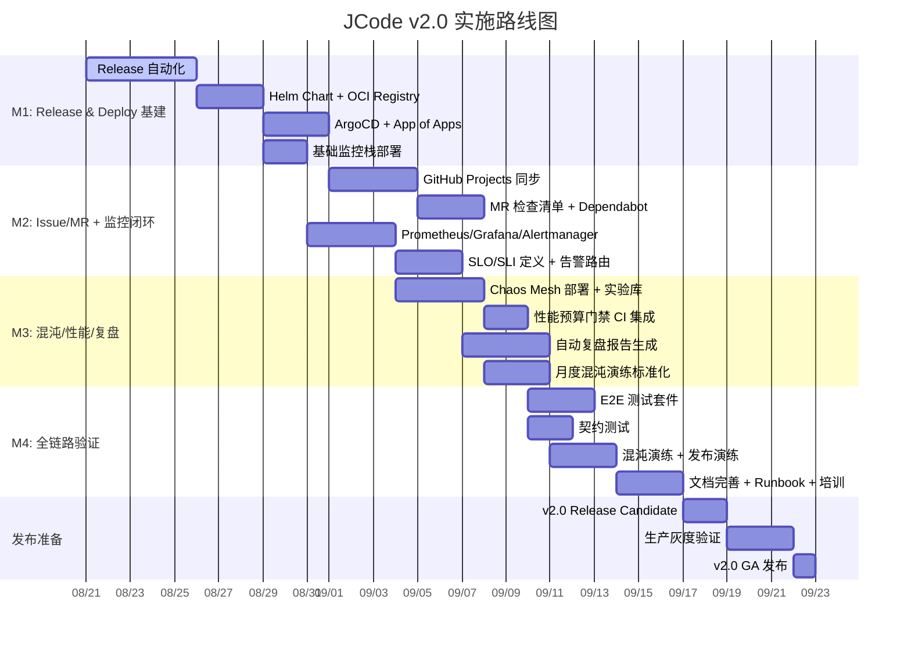

# JCode Platform v2.0 - 架构设计文档

> **版本**: 2.0  
> **状态**: 设计中  
> **关联**: PRD_v2.0.md

---

## 1. 系统总览

### 1.1 设计原则
- **云原生优先**: 容器化、声明式、不可变基础设施
- **GitOps 单一事实来源**: Git = 期望状态 = 实际状态
- **安全左移**: 策略即代码、准入即扫描、运行时即验证
- **可观测性内建**: 三大支柱 + 业务指标 + 语义追踪
- **AI 原生**: 可插拔 Agent 编排、人工兜底、持续学习

### 1.2 技术约束
- Kubernetes 1.28+ (最低)
- Go 1.22+ / Python 3.11+
- 多架构支持 (amd64/arm64)
- 离线/气隙环境支持

---

## 2. 核心组件架构

### 2.1 组件清单

| 组件 | 类型 | 职责 | 接口 |
|------|------|------|------|
| **jcode-cli** | CLI/Client | 用户交互、本地验证、触发远程 | CLI、gRPC |
| **jcode-api** | API Gateway | 统一入口、认证鉴权、限流、路由 | REST/gRPC |
| **jcode-orchestrator** | Workflow Engine | 编排引擎、状态机、补偿事务 | gRPC、事件总线 |
| **jcode-quality-gate** | Quality Service | 规则引擎、PR 审查、SBOM/签名 | gRPC |
| **jcode-semantic** | Semantic Service | 代码图谱、架构守卫、影响分析 | gRPC |
| **jcode-audit** | Audit Service | 审计账本、合规报告、溯源 | gRPC |
| **jcode-chaos** | Chaos Service | 故障注入、实验编排、自动验证 | gRPC |
| **jcode-retro** | Retrospective Service | 指标收集、AI 报告、知识沉淀 | gRPC |

### 2.2 基础设施组件

| 组件 | 版本 | 部署方式 | 配置管理 |
|------|------|----------|----------|
| **Kubernetes** | 1.28+ | 托管/自建 | Cluster API |
| **ArgoCD** | 2.9+ | Helm + Kustomize | App of Apps |
| **Prometheus Operator** | 0.70+ | Operator | CRD |
| **Grafana** | 10.2+ | Helm | Dashboard as Code |
| **Loki** | 2.9+ | Helm | 租户隔离 |
| **Tempo** | 2.3+ | Helm | TraceID 关联 |
| **Chaos Mesh** | 2.6+ | Operator | 实验 CRD |
| **Cert Manager** | 1.14+ | Helm | 证书自动化 |
| **External Secrets** | 0.9+ | Operator | Vault/AWS/GCP |

---

## 3. 数据流设计

### 3.1 核心流程：特性分支 → 生产

```
用户提交 PR
    │
    ▼
GitHub Webhook → jcode-api → jcode-orchestrator
    │
    ├─▶ DoR Check (jcode-orchestrator → jcode-quality-gate)
    │
    ├─▶ 语义分析 (jcode-semantic) ──▶ 架构守卫
    │
    ├─▶ 质量门禁 (jcode-quality-gate)
    │     ├─ 静态分析 (ruff/mypy/bandit/自定义规则)
    │     ├─ PR 审查 (AI 红蓝辩论 + 作用域守卫)
    │     ├─ SBOM 生成 (Syft) + 签名
    │     └─ 安全扫描
    │
    ├─▶ CI 构建 (Docker + SBOM + 签名 + 推送 Registry)
    │
    ├─▶ ArgoCD Sync (Staging) ──▶ 冒烟测试 ──▶ 混沌演练
    │
    └─▶ 手动/自动审批 → ArgoCD Sync (Production)
          │
          ▼
    金丝雀发布 (Istio/Argo Rollouts) → 指标监控 → 自动/手动全量
          │
          ▼
    部署后验证 (语义图对比 + 契约测试 + 遥测) → 完成/回滚
```

### 3.2 事件总线

| 事件 | 来源 | 消费者 | 用途 |
|------|------|--------|------|
| `pr.created` | GitHub | orchestrator | 触发流程 |
| `pr.merged` | GitHub | orchestrator | 触发部署 |
| `build.completed` | CI | orchestrator | 推进流程 |
| `deploy.completed` | ArgoCD | audit/retro | 记录/指标 |
| `incident.created` | Alertmanager | chaos/retro | 触发演练/复盘 |
| `chaos.experiment.completed` | chaos | retro | 记录结果 |
| `retro.generated` | retro | knowledge | 沉淀案例 |

---

## 4. 部署架构

### 4.1 环境拓扑

```
┌────────────────────────────────────────────────────────────────┐
│                      GitOps Repository                         │
│  ┌─────────────┐ ┌─────────────┐ ┌─────────────┐              │
│  │   apps/     │ │  infra/     │ │  clusters/  │              │
│  │ (应用清单)  │ │ (基础设施)  │ │ (集群差异)  │              │
│  └─────────────┘ └─────────────┘ └─────────────┘              │
└────────────────────────────────────────────────────────────────┘
                            │
                            ▼
┌────────────────────────────────────────────────────────────────┐
│                        ArgoCD (控制平面)                        │
│  ┌─────────────┐ ┌─────────────┐ ┌─────────────┐              │
│  │  Project:   │ │  Project:   │ │  Project:   │              │
│  │  platform   │ │  staging    │ │  production │              │
│  └─────────────┘ └─────────────┘ └─────────────┘              │
└────────────────────────────────────────────────────────────────┘
          │                    │                    │
          ▼                    ▼                    ▼
┌─────────────────┐ ┌─────────────────┐ ┌─────────────────┐
│   Staging K8s   │ │  Production K8s │ │   DR/Backup     │
│  (单集群/多NS)  │ │  (多集群/多AZ)  │ │  (异地灾备)     │
└─────────────────┘ └─────────────────┘ └─────────────────┘
```

### 4.2 应用部署模型

```yaml
# apps/jcode-platform/Chart.yaml
apiVersion: v2
name: jcode-platform
version: 2.0.0
appVersion: "2.0.0"
dependencies:
  - name: jcode-api
    version: "2.x.x"
    repository: "oci://registry.example.com/charts"
  - name: jcode-orchestrator
    version: "2.x.x"
    repository: "oci://registry.example.com/charts"
  - name: jcode-quality-gate
    version: "2.x.x"
    repository: "oci://registry.example.com/charts"
  - name: jcode-semantic
    version: "2.x.x"
    repository: "oci://registry.example.com/charts"
  - name: monitoring-stack
    version: "1.x.x"
    repository: "https://prometheus-community.github.io/helm-charts"
  - name: chaos-mesh
    version: "2.x.x"
    repository: "https://charts.chaos-mesh.org"
```

### 4.3 多环境差异化 (Kustomize)

```
clusters/
├── staging/
│   ├── kustomization.yaml
│   ├── namespace.yaml
│   ├── replicas-patch.yaml (replicas: 1)
│   ├── resources-patch.yaml (limits: 500Mi)
│   └── ingress-patch.yaml (staging.example.com)
└── production/
    ├── kustomization.yaml
    ├── namespace.yaml
    ├── replicas-patch.yaml (replicas: 3, HPA)
    ├── resources-patch.yaml (limits: 2Gi)
    ├── pod-disruption-budget.yaml
    ├── pod-anti-affinity.yaml
    └── ingress-patch.yaml (example.com, TLS)
```

---

## 5. 安全架构

### 5.1 供应链安全 (SLSA Level 3)

```
源代码 → 构建 (可复现) → SBOM (Syft) → 签名 → 验证策略 → 部署
   │         │            │           │        │         │
   ▼         ▼            ▼           ▼        ▼         ▼
Git 提交  hermetic build  SPDX/JSON  Cosign    OPA      ArgoCD
签名       (Nix/Bazel)    CycloneDX  (Keyless) Kyverno  只部署
                                                       签名验证通过
```

### 5.2 运行时安全

| 层级 | 措施 | 工具 |
|------|------|------|
| **集群** | Pod Security Standards (Restricted)、NetworkPolicy 默认拒绝 | Kyverno、Cilium |
| **节点** | CIS Benchmark、不可变节点、最小化 OS | Talos/Flatcar |
| **容器** | 非 root、只读根文件系统、无特权、Drop ALL capabilities | Pod Security Standards |
| **镜像** | 无 CVE 高危、SBOM 完整、签名验证、最小化基础镜像 | Trivy、Cosign、Distroless |
| **运行时** | Falco 行为监控、eBPF 系统调用审计 | Falco、Tetragon |
| **密钥** | Vault 动态凭证、外部 Secrets Operator、自动轮换 | Vault、ESO |

### 5.3 策略即代码

```rego
# policies/deployment.rego
package deployment

deny[msg] {
    input.kind == "Deployment"
    not input.spec.template.spec.securityContext.runAsNonRoot
    msg := "容器必须以非 root 用户运行"
}

deny[msg] {
    input.kind == "Deployment"
    not input.spec.template.spec.securityContext.readOnlyRootFilesystem
    msg := "根文件系统必须只读"
}

deny[msg] {
    input.kind == "Deployment"
    container := input.spec.template.spec.containers[_]
    not container.resources.limits.memory
    msg := sprintf("容器 %s 必须设置内存限制", [container.name])
}
```

---

## 6. 可观测性架构

### 6.1 三大支柱 + 语义追踪

| 支柱 | 组件 | 保留策略 | 关键指标 |
|------|------|----------|----------|
| **Metrics** | Prometheus + Thanos (长期存储) | 15d/热、1y/冷 | RED (Rate/Errors/Duration)、USE、业务 SLO |
| **Logs** | Loki + Promtail | 30d/热、1y/冷 | 结构化 JSON、TraceID 关联 |
| **Traces** | Tempo + OpenTelemetry Collector | 7d/热、90d/冷 | 端到端延迟、错误传播 |
| **语义追踪** | Semantic Graph + Audit Ledger | 永久 | 代码变更影响分析、架构漂移 |

### 6.2 关键 SLO 定义

| 服务 | SLI | SLO | 窗口 | 烧钱率告警 |
|------|-----|-----|------|------------|
| **jcode-api** | 可用性 (HTTP 2xx/3xx) | 99.95% | 30d | 2%/1h, 5%/6h |
| **jcode-api** | P95 延迟 < 200ms | 99% | 30d | - |
| **jcode-orchestrator** | 工作流成功率 | 99.9% | 7d | 1%/1h |
| **jcode-quality-gate** | 扫描通过率 | 95% | 7d | - |
| **ArgoCD** | 同步成功率 | 99.9% | 30d | - |
| **K8s 集群** | 节点就绪率 | 99.99% | 30d | - |

### 6.3 告警路由

```
Alertmanager
    │
    ├─▶ PagerDuty (P1: 页面/电话) ──▶ 核心服务不可用、SLO 烧钱率 > 2%
    │
    ├─▶ Slack #alerts-critical (P1/P2) ──▶ SLO 烧钱率、错误率飙升
    │
    ├─▶ Slack #alerts-warning (P3) ──▶ 资源压力、队列积压
    │
    └─▶ Email 日报 (P4) ──▶ 容量趋势、成本异常
```

---

## 7. 混沌工程架构

### 7.1 实验类型矩阵

| 故障域 | 实验类型 | 频次 | 自动化验证 |
|--------|----------|------|------------|
| **网络** | 延迟/丢包/分区/DNS 失效 | 周度 | 服务可用性、熔断生效 |
| **CPU** | 压力/限流/抢占 | 周度 | HPA 扩容、降级生效 |
| **内存** | OOM/Kill/泄漏 | 月度 | 重启恢复、无数据丢失 |
| **存储** | 磁盘满/IO 延迟/只读 | 月度 | 熔断、降级、告警 |
| **时钟** | 漂移/跳变/NTP 失效 | 季度 | 证书续期、定时任务 |
| **依赖** | 下游不可用/超时/错误码 | 周度 | 熔断/重试/降级 |

### 7.2 ChaosMesh 实验模板

```yaml
# chaos/experiments/network-latency.yaml
apiVersion: chaos-mesh.org/v1alpha1
kind: NetworkChaos
metadata:
  name: staging-api-latency
  namespace: chaos-mesh
spec:
  action: delay
  mode: one
  selector:
    namespaces:
      - staging
    labelSelectors:
      app: jcode-api
  delay:
    latency: "200ms"
    correlation: "25"
    jitter: "50ms"
  duration: "5m"
  scheduler:
    cron: "@weekly"
```

### 7.3 自动验证流程

```
实验开始
    │
    ▼
基线指标采集 (30s 前)
    │
    ▼
注入故障
    │
    ▼
持续监控 (实验期间)
    │
    ├─ SLO 违反? ──是──▶ 自动停止实验、标记失败、触发告警
    │
    ▼
实验结束
    │
    ▼
恢复验证 (指标回归基线 ±10%)
    │
    ▼
生成实验报告 → 存入审计账本 → 复盘服务消费
```

---

## 8. 性能预算门禁

### 8.1 基准管理

```yaml
# .perf_budget.yaml
budgets:
  semantic_code_graph:
    build_time_p95: 5s      # 当前 2.4s
    memory_p95: 500Mi       # 当前 ~200Mi
    node_count_max: 10000   # 当前 5963
  
  rules_engine:
    check_directory_p95: 10s    # 当前 6.5s
    parallel_speedup_min: 2.0x  # 当前 ~2.5x
    cache_hit_rate_min: 80%     # 当前 ~85%
  
  api:
    p95_latency: 200ms
    p99_latency: 500ms
    throughput_rps: 1000
    error_rate: 0.1%
```

### 8.2 CI 门禁集成

```yaml
# .github/workflows/perf-budget.yml
- name: Performance Budget Check
  run: |
    python tools/scripts/perf_benchmark.py --compare-baseline
    # 如果任意指标回归 > 10% 则失败
```

---

## 9. 自动化复盘架构

### 9.1 数据收集

```python
# tools/scripts/retro_collector.py
class RetroCollector:
    def collect_iteration_metrics(self, iteration_id: str) -> IterationMetrics:
        return IterationMetrics(
            # 交付指标
            deployment_frequency=self._get_deploy_freq(),
            lead_time=self._get_lead_time(),
            change_failure_rate=self._get_cfr(),
            mttr=self._get_mttr(),
            
            # 质量指标
            test_coverage=self._get_coverage(),
            defect_density=self._get_defect_density(),
            security_findings=self._get_security_findings(),
            
            # 架构指标
            arch_violations=self._get_arch_violations(),
            tech_debt_ratio=self._get_tech_debt(),
            
            # 团队指标
            cycle_time=self._get_cycle_time(),
            wip_limit_breaches=self._get_wip_breaches(),
            
            # AI 协作指标
            ai_pr_review_ratio=self._get_ai_review_ratio(),
            ai_code_gen_ratio=self._get_ai_gen_ratio(),
        )
```

### 9.2 AI 报告生成

```python
# tools/scripts/retro_generator.py
class RetroGenerator:
    def generate_report(self, metrics: IterationMetrics, context: str) -> Report:
        prompt = f"""
        基于以下迭代指标，生成结构化复盘报告：
        
        交付指标: {metrics.delivery}
        质量指标: {metrics.quality}
        架构指标: {metrics.architecture}
        团队指标: {metrics.team}
        AI协作: {metrics.ai_collaboration}
        
        上下文: {context}
        
        输出格式:
        1. 执行摘要 (3 句)
        2. 关键成就 (3-5 项)
        3. 关键问题 (根因 + 影响)
        4. 改进行动 (SMART 格式，责任人+截止日期)
        5. 知识沉淀 (新增案例/ADR/规则)
        """
        return self.llm.generate(prompt)
```

### 9.3 知识沉淀流程

```
迭代结束
    │
    ▼
收集指标 → AI 生成报告 → 人工审核/补全
    │
    ├─▶ 新增 ADR (架构决策)
    ├─▶ 新增 Case Study (成功/失败模式)
    ├─▶ 更新 Rule Pack (新规则/阈值调整)
    ├─▶ 更新 Runbook (操作手册)
    └─▶ 更新培训材料
    │
    ▼
提交 PR → 审核合并 → 知识库版本++
```

---

## 10. 实施优先级与依赖



---

## 11. 附录：API 契约示例

### 11.1 jcode-api OpenAPI 片段

```yaml
openapi: 3.0.3
info:
  title: JCode Platform API
  version: 2.0.0
paths:
  /api/v1/workflows:
    post:
      summary: 创建工作流执行
      requestBody:
        content:
          application/json:
            schema:
              $ref: '#/components/schemas/WorkflowRequest'
      responses:
        '201':
          description: 已创建
          content:
            application/json:
              schema:
                $ref: '#/components/schemas/WorkflowExecution'
components:
  schemas:
    WorkflowRequest:
      type: object
      required: [intent, pipeline]
      properties:
        intent:
          type: string
          minLength: 10
        pipeline:
          type: string
          enum: [full, quality-only, deploy-only]
        metadata:
          type: object
    WorkflowExecution:
      type: object
      properties:
        id:
          type: string
          format: uuid
        status:
          type: string
          enum: [pending, running, completed, failed, cancelled]
        steps:
          type: array
          items:
            $ref: '#/components/schemas/StepExecution'
        createdAt:
          type: string
          format: date-time
        completedAt:
          type: string
          format: date-time
```

---

**文档版本**: 2.0  
**最后更新**: 2026-08-20  
**负责人**: Platform Engineering Team  
**评审状态**: 待评审