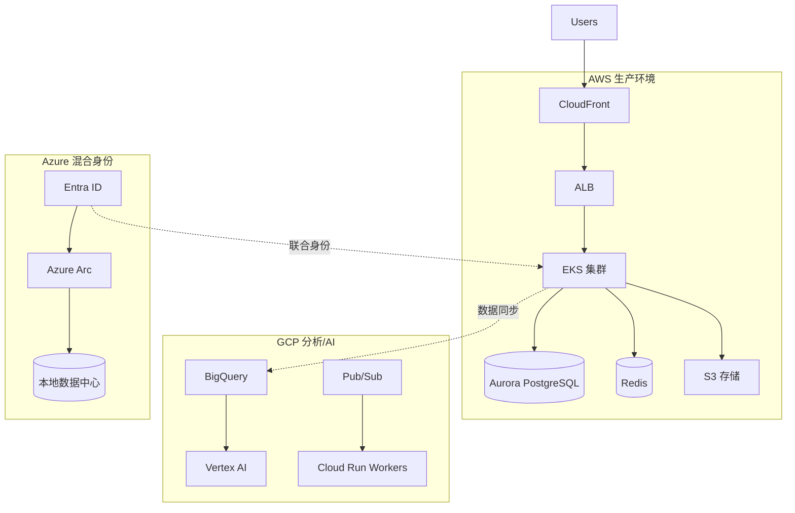

# 云平台选型与部署模式

> AWS / GCP / Azure 核心服务对比、落地架构、成本优化、多云策略。

---

## 1. 三大云核心服务映射

| 类别 | AWS | GCP | Azure |
|------|-----|-----|-------|
| **计算** | EC2, Lambda, ECS/EKS, Fargate | Compute Engine, Cloud Run, GKE, Cloud Functions | Virtual Machines, Container Apps, AKS, Functions |
| **容器编排** | EKS (托管 K8s) | GKE (最强 K8s) | AKS |
| **Serverless** | Lambda + API Gateway | Cloud Run (容器级 Serverless) | Container Apps / Functions |
| **数据库** | RDS, Aurora, DynamoDB, ElastiCache | Cloud SQL, AlloyDB, Spanner, Firestore, Memorystore | Azure SQL, Cosmos DB, Cache for Redis |
| **存储** | S3, EFS, FSx | Cloud Storage, Filestore | Blob Storage, Azure Files |
| **网络** | VPC, ALB/NLB, CloudFront, Route 53 | VPC, Cloud Load Balancing, Cloud CDN, Cloud DNS | Virtual Network, Application Gateway, Front Door, DNS |
| **消息队列** | SQS, SNS, EventBridge, Kinesis, MSK | Pub/Sub, Dataflow, Kafka (Managed) | Service Bus, Event Grid, Event Hubs |
| **监控** | CloudWatch, X-Ray | Cloud Monitoring, Cloud Trace, Cloud Profiler | Azure Monitor, Application Insights |
| **CI/CD** | CodePipeline, CodeBuild | Cloud Build, Cloud Deploy | Azure DevOps, GitHub Actions |
| **IaC** | CloudFormation, CDK | Deployment Manager, Terraform | Bicep, ARM, Terraform |
| **密钥管理** | Secrets Manager, KMS | Secret Manager, Cloud KMS | Key Vault |
| **身份** | IAM, Cognito | IAM, Identity Platform | Entra ID (AAD) |

---

## 2. 选型决策矩阵

| 场景 | 首选 | 备选 | 理由 |
|------|------|------|------|
| **Kubernetes 原生、重容器** | **GCP (GKE)** | EKS | GKE 版本最新、自动化最强、成本优化最好 |
| **企业级混合云、Windows 生态** | **Azure** | AWS | AD 集成、混合云、Windows Server 许可优势 |
| **Serverless 优先、事件驱动** | **GCP (Cloud Run)** | AWS Lambda | Cloud Run 支持容器、冷启动快、按请求计费 |
| **全球 CDN、边缘计算** | **AWS (CloudFront)** / **Cloudflare** | Azure Front Door | CloudFront PoP 最多、Lambda@Edge 强 |
| **数据分析、AI/ML** | **GCP (BigQuery, Vertex AI)** | AWS (Redshift, SageMaker) | BigQuery 无服务器、Vertex AI 托管完整 |
| **合规、主权云、政府** | **AWS GovCloud** / **Azure Government** | - | FedRAMP、ITAR、数据驻留 |
| **成本敏感、初创** | **GCP** (持续使用折扣) | AWS (Savings Plans) | GCP 自动折扣、无需预付 |
| **现有 AWS 投入深** | **AWS** | - | 迁移成本高、生态锁定 |

---

## 3. 典型落地架构

### 3.1 标准三层 Web 应用 (AWS)
```
Internet → CloudFront → ALB (公网子网)
                    ↓
            ECS Fargate / EKS (私网子网)
                    ↓
         RDS Aurora (多AZ) + ElastiCache Redis
                    ↓
              S3 (静态资源) + CloudFront
```

### 3.2 微服务 + 事件驱动 (GCP)
```
Internet → Cloud Load Balancing → Cloud Run (服务网格)
                    ↓
         Cloud SQL (PostgreSQL) + Memorystore Redis
                    ↓
         Pub/Sub (事件总线) → Cloud Run Workers
                    ↓
         BigQuery (分析) + Cloud Storage (数据湖)
```

### 3.3 混合云 / 数据驻留 (Azure)
```
On-Prem (Azure Stack / Arc) ↔ ExpressRoute / VPN ↔ Azure
                    ↓
         AKS (混合节点池) + Azure SQL MI
                    ↓
         Entra ID (混合身份) + Azure Policy (统一治理)
```

---

## 4. 成本优化清单

| 优化手段 | AWS | GCP | Azure | 预估节省 |
|----------|-----|-----|-------|----------|
| **计算折扣** | Savings Plans (1-3年) | CUD (承诺使用折扣) | Reserved Instances | 30-60% |
| **Spot/抢占式** | EC2 Spot (90% off) | Preemptible VMs (80% off) | Spot VMs | 70-90% |
| **Serverless** | Lambda / Fargate | Cloud Run / Cloud Functions | Container Apps | 按需付费 |
| **存储分层** | S3 IA/Glacier | Nearline/Coldline/Archive | Cool/Archive Access | 50-95% |
| **数据库** | Aurora Serverless v2 | Cloud SQL 自动扩容 | Azure SQL Serverless | 低负载 90%+ |
| **网络** | VPC Endpoints (免 NAT) | Private Service Connect | Private Endpoints | 数据传输费 |
| **权限收敛** | IAM 条件、边界策略 | IAM Conditions、VPC-SC | PIM、条件访问 | 安全+成本 |

### 成本监控
```yaml
# 关键指标告警
- 每日成本 > 预算 110% → 告警
- 单服务成本环比 > 20% → 告警
- 未使用资源 (EBS 快照、未关联 EIP、空闲 LB) → 周报
- Savings Plans 利用率 < 80% → 月度审查
```

---

## 5. 多云策略

### 5.1 何时多云
- **合规/数据主权**：某地区数据不出境
- **灾备**：单云区域级故障兜底
- **议价能力**：避免单一厂商锁定
- **最佳服务组合**：各云取长补短

### 5.2 多云架构模式
| 模式 | 描述 | 复杂度 | 适用 |
|------|------|--------|------|
| **主备** | 主云跑生产，备云同步数据、冷备 | 低 | 灾备、合规 |
| **多活** | 多云同时服务流量、DNS 分发 | 高 | 核心业务、全球低延迟 |
| **专用云** | 特定工作负载跑特定云 (ML 跑 GCP) | 中 | 专项能力互补 |

### 5.3 多云工具链
| 领域 | 工具 |
|------|------|
| **IaC** | Terraform (原生多云)、Pulumi、Crossplane |
| **K8s 管理** | Fleet (GCP)、Cluster API、Rancher、ArgoCD (多集群) |
| **网络互联** | Cloud Interconnect、ExpressRoute、VPN、Transit Gateway |
| **观测** | Datadog、Grafana Cloud、Datadog、Honeycomb (统一视图) |
| **密钥** | HashiCorp Vault、Akeyless、云厂商原生 + 外部密钥存储 |

---

## 6. 落地清单

| 阶段 | 关键动作 |
|------|----------|
| **选型** | 业务需求 → 服务映射 → PoC 验证 → 决策文档 |
| **落地** | 账号结构 (OU/Projects/Subscriptions) → 网络拓扑 → IAM 最小权限 → 监控基线 |
| **迁移** | 评估工具 (AWS MGN, Migrate for Compute Engine, Azure Migrate) → 分波次 → 双写验证 → 切流量 |
| **运维** | FinOps 流程 → 变更管理 → 事件响应 → 容量规划 → 季度架构审查 |

---

## 7. 常见坑

| 坑 | 云厂商 | 后果 | 规避 |
|----|--------|------|------|
| **默认 VPC/网络** | 全部 | 安全组过宽、无私网隔离 | 删默认、自建 VPC、最小 CIDR |
| **IAM 过度授权** | 全部 | 横向移动、数据泄露 | 最小权限、边界策略、定期审计 |
| **未加密存储** | 全部 | 合规失败、数据泄露 | 默认加密、KMS 自带密钥 |
| **无预算告警** | 全部 | 账单惊吓 | 预算 + 告警、每日成本报表 |
| **单区域部署** | 全部 | 区域故障全挂 | 多 AZ、跨区域 DR |
| **手动创建资源** | 全部 | 状态漂移、不可复现 | 100% IaC、GitOps |
| **忽略数据传输费** | AWS/GCP | 跨区域/公网流量账单高 | VPC Peering/Private Link、同区域部署 |

---

## 8. 参考架构图 (Mermaid)



---

*云是工具，架构才是核心竞争力。最后更新: 2026-07-20*