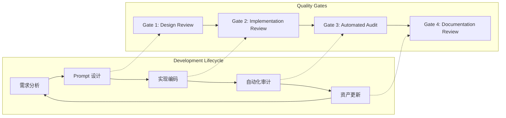
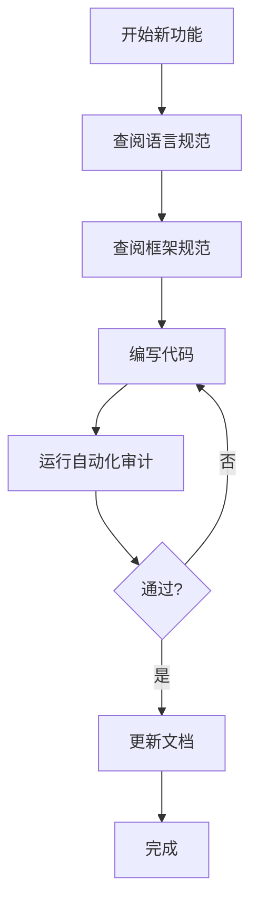

# 治理框架可视化地图

## 整体架构

```mermaid
graph TB
    subgraph "Universal Governance Framework"
        GOV[GOVERNANCE.md<br/>通用治理标准]
        
        subgraph "Programming Languages"
            PY[Python]
            RS[Rust]
            TS[TypeScript]
            GO[Go]
            JA[Java]
            CS[C#]
            KT[Kotlin]
            PH[PHP]
            RB[Ruby]
            CPP[C/C++]
            SW[Swift]
            SC[Scala]
            EL[Elixir]
        end
        
        subgraph "Frameworks"
            REACT[React]
            VUE[Vue]
            ANG[Angular]
            SVEL[Svelte]
            NEXT[Next.js]
            NEST[NestJS]
            EXPRESS[Express]
            FLASK[Flask]
            DJANGO[Django]
            FAST[FastAPI]
            SPRING[Spring Boot]
        end
        
        subgraph "DevOps & Infrastructure"
            DOCKER[Docker]
            K8S[Kubernetes]
            CICD[CI/CD]
        end
        
        subgraph "Data Layer"
            SQL[SQL]
            NOSQL[NoSQL]
        end
        
        subgraph "API Design"
            REST[RESTful]
            GRAPHQL[GraphQL]
            GRPC[gRPC]
        end
        
        subgraph "Security"
            AUTH[Authentication]
            OWASP[OWASP Top 10]
        end
        
        subgraph "Testing & Workflow"
            TEST[Testing Strategy]
            GIT[Git Workflow]
        end
    end
    
    GOV --> PY & RS & TS & GO & JA & CS & KT & PH & RB & CPP & SW & SC & EL
    GOV --> REACT & VUE & ANG & SVEL & NEXT & NEST & EXPRESS & FLASK & DJANGO & FAST & SPRING
    GOV --> DOCKER & K8S & CICD
    GOV --> SQL & NOSQL
    GOV --> REST & GRAPHQL & GRPC
    GOV --> AUTH & OWASP
    GOV --> TEST & GIT
```



## 质量门禁流程



## 文件结构

```
ai_developer_growth/
├── GOVERNANCE.md                    # 通用治理标准 (入口)
├── docs/
│   ├── governance/
│   │   ├── MAP.md                   # 本文件 - 可视化地图
│   │   ├── INSTALL.md               # 安装指南
│   │   └── languages/               # 13 种语言规则
│   │       ├── python.md
│   │       ├── rust.md
│   │       ├── typescript.md
│   │       ├── go.md
│   │       ├── java.md
│   │       ├── csharp.md
│   │       ├── kotlin.md
│   │       ├── php.md
│   │       ├── ruby.md
│   │       ├── cpp.md
│   │       ├── swift.md
│   │       ├── scala.md
│   │       └── elixir.md
│   ├── frameworks/                  # 11 种框架规则
│   │   ├── react.md
│   │   ├── vue.md
│   │   ├── angular.md
│   │   ├── svelte.md
│   │   ├── nextjs.md
│   │   ├── nestjs.md
│   │   ├── express.md
│   │   ├── flask.md
│   │   ├── django.md
│   │   ├── fastapi.md
│   │   └── springboot.md
│   ├── devops/                      # DevOps 规范
│   │   ├── docker.md
│   │   ├── kubernetes.md
│   │   └── cicd.md
│   ├── database/                    # 数据库规范
│   │   ├── sql.md
│   │   └── nosql.md
│   ├── api/                         # API 设计规范
│   │   ├── rest.md
│   │   ├── graphql.md
│   │   └── grpc.md
│   ├── security/                    # 安全规范
│   │   ├── authentication.md
│   │   └── owasp.md
│   └── testing/                     # 测试与工作流
│       ├── strategy.md
│       └── git-workflow.md
```

## 使用指南

### 1. 快速入门

```bash
# 复制治理标准到你的项目
cp GOVERNANCE.md /path/to/your/project/

# 查看安装指南
cat docs/governance/INSTALL.md
```

### 2. 选择适用规范

根据你的技术栈选择对应文档：
- **语言**: `docs/governance/languages/{language}.md`
- **框架**: `docs/frameworks/{framework}.md`
- **领域**: `docs/{category}/{topic}.md`

### 3. 集成到开发流程



## 覆盖范围统计

| 类别 | 数量 | 覆盖 |
|------|------|------|
| 编程语言 | 13 | 主流语言全覆盖 |
| 框架 | 11 | 前后端主流框架 |
| DevOps | 3 | 容器化 + CI/CD |
| 数据库 | 2 | SQL + NoSQL |
| API | 3 | REST/GraphQL/gRPC |
| 安全 | 2 | 认证 + OWASP |
| 测试 | 2 | 策略 + Git 工作流 |
| **总计** | **36** | **完整覆盖** |

---

*本地图随项目演进持续更新。最后更新: 2026-07-17*
