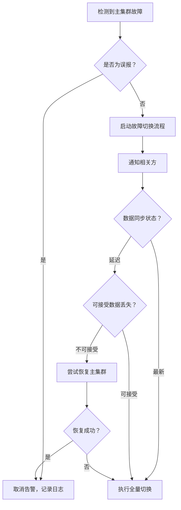

# 灾难恢复 - 全量故障切换运行手册

> **文档版本**: v1.0  
> **最后更新**: 2024-01-20  
> **审批人**: Platform Team Lead  
> **适用场景**: 主集群完全不可用，需全量切换到 DR 集群

---

## 1. 先决条件检查

### 1.1 确认故障范围
- [ ] 确认主集群完全不可访问（API Server、控制平面、工作节点）
- [ ] 确认不是网络分区问题（检查跨区域网络连通性）
- [ ] 确认不是单个组件故障（如仅 Ingress 故障、单个服务异常）

### 1.2 确认 DR 集群状态
- [ ] DR 集群控制平面健康（`kubectl get nodes -n dr`）
- [ ] DR 集群存储充足（`kubectl get pvc -A -n dr`）
- [ ] DR 集群网络正常（跨区域连通性、DNS 解析）
- [ ] ArgoCD 在 DR 集群正常运行
- [ ] 监控告警系统正常（Prometheus、Grafana、Alertmanager）

### 1.3 数据一致性确认
- [ ] 最近一次备份完成时间：______
- [ ] 备份完整性校验通过
- [ ] RPO 符合要求（≤ 1 小时数据丢失）

---

## 2. 故障切换决策流程



---

## 3. 全量切换步骤

### 3.1 阶段 1：准备与通知 (T+0 ~ T+15min)

#### 3.1.1 成立故障响应小组
- [ ] 事件指挥官：___________
- [ ] 技术负责人：___________
- [ ] 运维工程师：___________
- [ ] 业务联络人：___________
- [ ] 沟通渠道：Slack #incident-response / 电话会议

#### 3.1.2 发布事故通知
- [ ] 发送 PagerDuty 严重级告警
- [ ] 发送 Slack #incident-alerts 通知
- [ ] 发送邮件给相关干系人
- [ ] 更新状态页

#### 3.1.3 冻结变更
- [ ] 冻结所有生产环境部署
- [ ] 冻结数据库 Schema 变更
- [ ] 冻结配置变更
- [ ] 记录冻结时间：__________

### 3.2 阶段 2：数据同步与验证 (T+15min ~ T+45min)

#### 3.2.1 数据库同步检查
```bash
# 检查主从复制延迟
kubectl exec -it postgres-primary-0 -n production -- \
  psql -c "SELECT * FROM pg_stat_replication;"

# 检查最近备份
kubectl exec -it postgres-primary-0 -n production -- \
  ls -la /backups/
```

#### 3.2.2 对象存储同步
```bash
# 检查 S3 复制状态
aws s3 ls s3://jcode-backups/ --recursive | tail -20

# 检查跨区域复制状态
aws s3api get-bucket-replication --bucket jcode-backups
```

#### 3.2.3 配置同步
```bash
# 检查 ConfigMap/Secret 同步
argocd app diff jcode-platform --server dr-us-west-2

# 同步 ConfigMap
argocd app sync jcode-platform --server dr-us-west-2 --prune
```

### 3.3 阶段 3：流量切换 (T+45min ~ T+75min)

#### 3.3.1 DNS 切换
```bash
# 更新 Route53 记录
aws route53 change-resource-record-sets \
  --hosted-zone-id Z123456789ABCD \
  --change-batch file://dns-failover.json

# 验证 DNS 传播
dig @8.8.8.8 api.jcode.example.com
```

#### 3.3.2 负载均衡器切换
```bash
# 更新 ALB 目标组
aws elbv2 modify-target-group \
  --target-group-arn arn:aws:elasticloadbalancing:us-east-1:123456789012:targetgroup/jcode-api/abc123 \
  --targets Id=i-dr-instance-1,Port=8080 Id=i-dr-instance-2,Port=8080

# 验证健康检查
aws elbv2 describe-target-health \
  --target-group-arn arn:aws:elasticloadbalancing:us-east-1:123456789012:targetgroup/jcode-api/abc123
```

#### 3.3.3 验证服务可用性
```bash
# 健康检查
curl -f https://api.jcode.example.com/health

# 业务功能测试
curl -X POST https://api.jcode.example.com/api/v1/test \
  -H "Authorization: Bearer $TEST_TOKEN"
```

### 3.4 阶段 4：验证与监控 (T+75min ~ T+120min)

#### 3.4.1 核心功能验证
- [ ] API 健康检查通过
- [ ] 用户登录/认证正常
- [ ] 核心业务流程可用
- [ ] 数据库读写正常
- [ ] 缓存/消息队列正常
- [ ] 文件存储/对象存储正常

#### 3.4.2 监控告警验证
- [ ] Prometheus 采集正常
- [ ] Grafana 仪表板正常
- [ ] 告警规则触发正常
- [ ] 日志采集正常
- [ ] 链路追踪正常

#### 3.4.3 性能基线对比
- [ ] 延迟 P95 < 200ms
- [ ] 错误率 < 0.1%
- [ ] 吞吐量达到预期

### 3.5 阶段 5：通知与文档 (T+120min ~ T+150min)

#### 3.5.1 发布恢复通知
- [ ] 发送 PagerDuty 恢复通知
- [ ] 发送 Slack 恢复通知
- [ ] 发送邮件通知相关干系人
- [ ] 更新状态页为"运行中"

#### 3.5.2 记录事故报告
- [ ] 记录故障时间线
- [ ] 记录根因分析
- [ ] 记录影响范围
- [ ] 记录恢复时间
- [ ] 记录数据丢失量（如有）
- [ ] 制定改进措施

---

## 4. 回滚方案

如果 DR 集群也出现问题，执行以下回滚：

### 4.1 回滚 DNS
```bash
# 恢复主集群 DNS
aws route53 change-resource-record-sets \
  --hosted-zone-id Z123456789ABCD \
  --change-batch file://dns-rollback.json
```

### 4.2 回滚负载均衡器
```bash
# 恢复 ALB 目标组
aws elbv2 modify-target-group \
  --target-group-arn arn:aws:elasticloadbalancing:us-east-1:123456789012:targetgroup/jcode-api/abc123 \
  --targets Id=i-prod-instance-1,Port=8080 Id=i-prod-instance-2,Port=8080
```

### 4.3 数据库回滚
```bash
# 如果主集群恢复，重新建立主从复制
kubectl exec -it postgres-primary-0 -n production -- \
  psql -c "SELECT pg_terminate_backend(pid) FROM pg_stat_replication;"
```

---

## 5. 事后复盘模板

### 5.1 事故摘要
| 字段 | 内容 |
|------|------|
| 事故编号 | INC-YYYYMMDD-XXX |
| 发生时间 | YYYY-MM-DD HH:MM:SS (UTC) |
| 恢复时间 | YYYY-MM-DD HH:MM:SS (UTC) |
| 持续时间 | XX 分钟 |
| 影响范围 | 核心 API / 全部服务 / 部分服务 |
| 影响用户数 | 约 XX% 用户 |
| 数据丢失 | 无 / XX 条记录 / XX MB |

### 5.2 时间线
| 时间 | 事件 | 责任人 | 备注 |
|------|------|--------|------|
| T+0 | 故障检测 | | |
| T+5 | 确认故障 | | |
| T+10 | 启动切换 | | |
| T+30 | DNS 切换完成 | | |
| T+60 | 服务恢复 | | |
| T+120 | 全面验证通过 | | |

### 5.3 根因分析
**直接原因**: _______________
**根本原因**: _______________
**促成因素**: _______________

### 5.4 改进措施
| 编号 | 改进措施 | 责任人 | 完成时间 | 状态 |
|------|----------|--------|----------|------|
| 1 | | | | 待办 |
| 2 | | | | 待办 |
| 3 | | | | 待办 |

---

## 6. 附录

### 6.1 关键联系人
| 角色 | 姓名 | 电话 | 邮箱 | Slack |
|------|------|------|------|-------|
| 事件指挥官 | | | | |
| 技术负责人 | | | | |
| 运维工程师 | | | | |
| DBA | | | | |
| 业务联络人 | | | | |

### 6.2 关键命令速查
```bash
# 查看集群状态
kubectl get nodes -n dr

# 查看 ArgoCD 应用状态
argocd app list --server dr-us-west-2

# 查看数据库复制状态
kubectl exec -it postgres-primary-0 -n dr -- psql -c "SELECT * FROM pg_stat_replication;"

# 查看 ArgoCD 应用同步状态
argocd app get jcode-platform --server dr-us-west-2

# 查看 DNS 记录
dig @8.8.8.8 api.jcode.example.com

# 查看负载均衡器健康检查
aws elbv2 describe-target-health --target-group-arn arn:aws:elasticloadbalancing:us-west-2:xxx:targetgroup/jcode-api/xxx
```

### 6.3 关键配置文件位置
| 文件 | 路径 |
|------|------|
| DNS 切换脚本 | `scripts/dns-failover.sh` |
| 数据库同步检查 | `scripts/db-sync-check.sh` |
| 服务验证脚本 | `scripts/service-validation.sh` |
| 通知模板 | `templates/incident-notification.tmpl` |
| 复盘报告模板 | `templates/postmortem-template.md` |

---

**文档控制**
- 版本: v1.0
- 审核周期: 每季度
- 下次审核: 2024-04-20
- 文档所有者: Platform Team